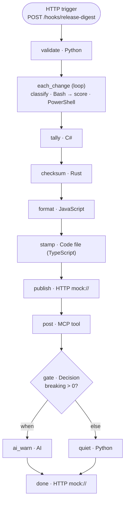

Bring everything together. You'll build **Release notes digest**, a workflow that:

- starts from an **HTTP trigger** with a list of change titles;
- **validates** the input in Python;
- **loops** over each change, classifying it in **Bash** and scoring it in **PowerShell**;
- counts results in **C#**, computes a checksum in **Rust**, and formats Markdown in **JavaScript**;
- runs a **Code file** written in **TypeScript**;
- publishes through an **HTTP** endpoint (`mock://`) and an **MCP** tool;
- **branches** on whether there are breaking changes, asking an **AI** model for an upgrade warning only when there are.

{}
