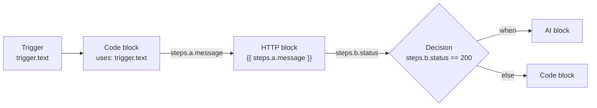

{}
Learn the terms used in the rest of the course. **Time:** 5 minutes. **Needs:** nothing.
{}

A **workflow** is a sequence you'll want to run again. In Termorq it is one YAML file. The **Editor** tab shows it as a canvas and the **YAML** tab shows the same file as text. Changes on one tab appear on the other, because both edit the same file.

## The vocabulary

| Term | Meaning |
| --- | --- |
| **Block** (or **node**) | One step. A node on the canvas is a block in the YAML. |
| **Kind** | The block's type: `code`, `code_file`, `http`, `mcp`, `ai`, `decision`, or `loop`. The editor also lists `git` (Git file), but it isn't runnable yet. |
| **Property** | A named value that a block publishes, such as `steps.lookup.total`. |
| **Output schema** | The `outputs:` declaration listing the properties a block promises to publish and their types. |
| **`uses`** | The list of properties a code block reads. Termorq writes those properties into a JSON file for the block. |
| **Run** | One execution. Each run gets its own folder with `run.json`, logs, and a `files/` directory. |
| **Trigger** | What starts the workflow automatically: a schedule, app startup, another workflow, a file change, an HTTP request, or a Telegram message. Manual **Run** is always available. |

## How data flows

Data moves forward **only** through declared properties:

- A **code** block lists the paths it needs under `uses`. At run time it reads them from a JSON file whose path is in `TERMORQ_INPUT`.
- An **HTTP**, **MCP**, or **AI** block uses `{{ steps.<id>.<property> }}` templates in its fields.
- Every block publishes properties. A later block reads them as `steps.<block id>.<property>`.

Each code block runs as its own process. A shell variable set in one block doesn't exist in the next one. To pass a value on, publish it as a property.

## Workflows are not runbooks

Termorq also has collection runbooks, Markdown runbooks, and repo runbooks. These are separate features, and nothing in this course changes them.

{}
You're ready to move on if you can answer these: *How does block B read a value from block A?* (A declares it in `outputs`, and B lists `steps.A.<name>` in `uses` or uses a `{{ }}` template.) *Does `export X=1` in one Bash block reach the next block?* (No. Each block is its own process.)
{}

{}
Draw on paper the data flow for: "every morning, call an API, and if it returns any users, summarise them with AI". Label each arrow with the property it carries.
{}

{}
Schedule trigger (`every: 1d`) → HTTP block `list_users` (publishes `status`, `body`, and `count`) → Decision (`steps.list_users.count > 0`) → AI block `summarise` (prompt contains `{{ steps.list_users.body }}`) → publishes `summary`.
{}

**Reference:** [Build a workflow](https://termorq-docs.garrardkitchen.com/docs/workflows/the-page/)
